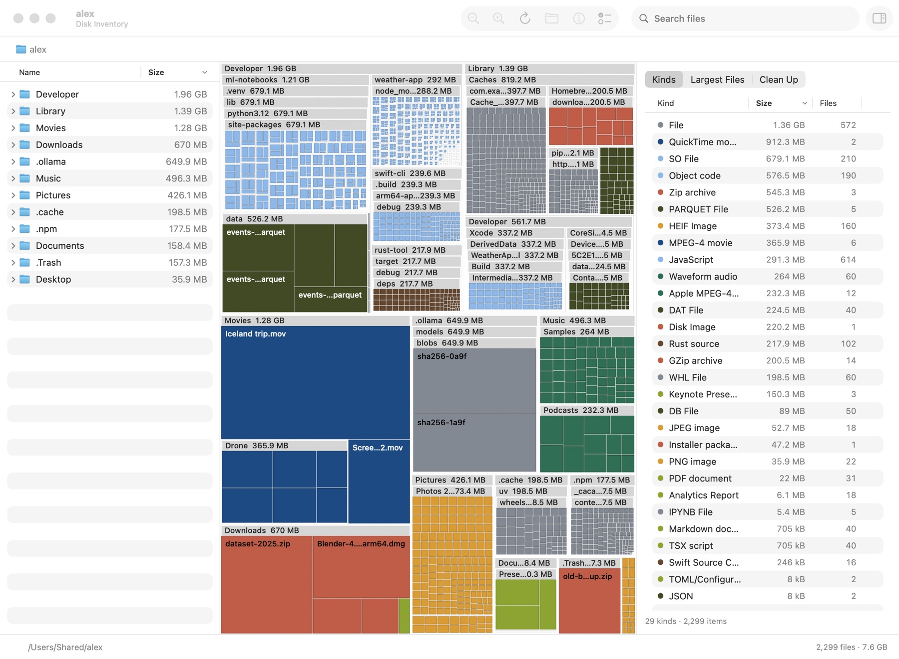

# Disk Inventory

Нативный порт Disk Inventory X для macOS 26 и Apple Silicon: карта занятого места, дерево и типы файлов, уборка (что можно удалить и что давно не открывали) и MCP-сервер, через который агент видит тот же скан.



## Быстрый старт

```sh
git clone git@github.com:kpeeem/DiskInventory.git
```

```sh
cd DiskInventory && ./Scripts/build-app.sh
```

```sh
open "dist/Disk Inventory.app"
```

Нужны Xcode 27 и macOS 26. Скрипт подписывает приложение первым сертификатом из Связки ключей (если его нет — ad hoc), поэтому «Полный доступ к диску» не слетает после пересборки. Без этого доступа защищённые папки попадут в **skipped**.

MCP-сервер для Claude Code:

```sh
./Scripts/build-mcp.sh
```

```sh
claude mcp add --scope user inventory "$PWD/dist/inventorymcp"
```

## Уборка

**File → Clean Up…** (⇧⌘K) или кнопка **Clean Up** в тулбаре открывает окно для текущего скана.


- **Remove** — найденное разложено по безопасности. *Safe to Remove*: кэши программ, журналы, Корзина (её очищают в Finder). *Rebuilt on Demand*: `node_modules`, `.build`, `target`, виртуальные окружения Python и прочие артефакты сборки (только рядом с файлом проекта: `package.json`, `Package.swift`, `Cargo.toml`…), кэши npm/uv/pip/Gradle/Cargo, DerivedData и Device Support Xcode. *Worth a Look*: установщики и образы в Загрузках и на Рабочем столе, локальные модели ИИ, устройства симулятора, архивы Xcode, резервные копии iPhone. Безопасная группа отмечена заранее; всё уходит в Корзину только после подтверждения. Внутри `~/Library` (кроме перечисленных мест), скрытых папок в домашней и пакетов приложений артефакты не ищутся — там `node_modules` чаще всего нужен самой программе.
- **Move to Cloud** — крупные файлы в Desktop, Documents, Downloads, Movies, Music, Pictures и iCloud Drive, которые не открывали и не меняли дольше выбранного срока. Дата — самая поздняя из «последнего открытия» по Spotlight, изменения и добавления. Файлы переносятся в iCloud Drive или Google Drive в папку «Archived from Mac» с сохранением структуры; для того, что уже лежит в iCloud, есть **Remove Download** — файл остаётся в облаке, а место на Mac освобождается. Место возвращается после выгрузки и удаления локальной копии.

После любого действия скан обновляется точечно, без полного обхода.

## Сканирование

На APFS обход параллельный: общая очередь папок, свободные потоки забирают поддеревья, до которых занятые ещё не дошли; атрибуты читаются пакетами через `getattrlistbulk`, а части скана сливаются с перенумерацией узлов и однократным учётом hard links. Выгруженные в iCloud (dataless) папки учитываются, но не открываются, так что скан ничего не скачивает.

| Каталог | Записей | 1.5, один поток | 1.6, очередь |
|---|---:|---:|---:|
| `/Applications/Xcode.app/Contents/Developer` | 152 452 | 1,3–2,5 с | 1,0–1,6 с |
| `~/Dev` | 3,9 млн | 121 с | 31 с |
| `~` целиком | 8,2 млн | около часа в 1.3 | 132 с |

Число записей и байты совпадают с последовательным обходом; пик памяти на `~/Dev` — 1,0 ГБ против 0,75 ГБ (части скана живут до слияния).

## MCP

`inventorymcp` держит скан в памяти 30 минут и отвечает только на чтение:

| Инструмент | Что делает |
|---|---|
| `inventory_scan` | полный скан папки или тома (`/System/Volumes/Data` — весь загрузочный том) |
| `inventory_children`, `inventory_top` | обход по уровням и самые большие файлы или папки где угодно внутри |
| `inventory_kinds`, `inventory_search` | место по типам файлов и поиск по имени, типу или пути |
| `inventory_cleanup` | то же, что вкладка Remove, с суммами по уровням безопасности |
| `inventory_stale` | то же, что вкладка Move to Cloud, плюс найденные облачные папки |
| `inventory_status` | доступ к защищённым папкам, облачные папки, сканы в памяти |

## Работа с картой

Перетащите заголовок, чтобы поменять порядок колонок. Для изменения ширины потяните границу заголовка. Размеры панелей меняются перетаскиванием вертикальных разделителей между деревом, картой и инспектором. Подробности в [аудите интерфейса](Research/ui-ux-audit.md).

- Площадь прямоугольника пропорциональна размеру. Дерево, карта и список результатов показывают одно выделение. Двойной клик по папке приближает её, путь над картой возвращает к родительским папкам.
- **Kinds** показывает количество, размеры и цвета групп файлов. Двойной клик по группе открывает её в **Selection List**. В списке можно искать по имени, типу или полному пути.
- Открытие, просмотр в Finder, сведения, копирование пути и перенос в Корзину доступны из меню файла или контекстного меню. **Refresh Selection** перечитывает выбранный участок, **Refresh All** пересканирует окно.
- В меню **View** переключаются размер на диске и логический размер, содержимое пакетов, свободное и прочее место. На томах **Kinds** дополнительно показывает диаграмму занятого, прочего и свободного места.
- В Finder папку можно перетащить на иконку приложения или передать через **Services → Scan with Disk Inventory**. Этот сервис заменяет старый Finder-плагин.
- При выборе загрузочного тома сканируется его записываемая часть APFS. Значение **Other** использует остаток по данным файловой системы. APFS-клоны, снимки и системные резервы влияют на расхождение с Finder и на объём, который реально освободится после удаления.

## Настройки

**Disk Inventory → Settings… (⌘,)** открывает три вкладки.

- **Appearance** — системное, светлое или тёмное оформление, четыре палитры карты с предпросмотром, подписи, границы папок, расположение панелей и компактный текст дерева.
- **Scanning** — размер на диске или логический размер, содержимое пакетов, названия типов Finder и показ свободного и прочего места.
- **Behavior** — анимация зума, общие цвета типов между окнами, синхронизация с Finder и подтверждение переноса в Корзину.

Оформление применяется к открытым окнам сразу. Настройки сохраняются между запусками.

## Проверка

```sh
CLANG_MODULE_CACHE_PATH="$PWD/.build/module-cache" swift test --disable-sandbox --cache-path "$PWD/.build/cache"
```

CLI сканирует метаданные без открытия окна. Флаг `--finder-kinds` включает подробные имена типов для `--scan` и `--fts`. Ключ `--fts` запускает прежний файловый обход для сравнения. Ключ `--baseline` обходит дерево через Foundation и считает число объектов и логические байты.

```sh
binary="dist/Disk Inventory.app/Contents/MacOS/DiskInventory"
"$binary" --scan /Applications/Xcode.app/Contents/Developer
"$binary" --fts /Applications/Xcode.app/Contents/Developer
"$binary" --baseline /Applications/Xcode.app/Contents/Developer
```

[Разбор установленной Disk Inventory X 1.3 и замеры](Research/analysis.md).
