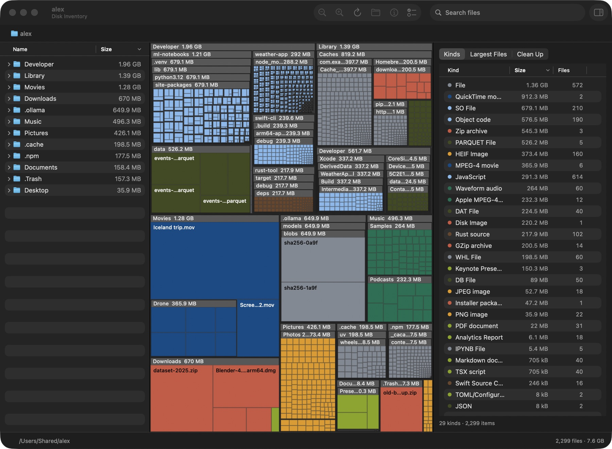

# Disk Inventory

[](https://github.com/kpeeem/DiskInventory/releases/latest)
[](LICENSE)


English · [Русский](README.ru.md)

> **TL;DR** — A native Swift remake of Disk Inventory X for Apple Silicon: a treemap of every file, a Clean Up tab that sorts junk by how safe it is to delete, and an MCP server so Claude can scan your disk and send its cleanup advice straight into the app. Nothing is deleted until you confirm.


## Install

1. Download `DiskInventory-*.zip` from [Releases](https://github.com/kpeeem/DiskInventory/releases/latest) and move the app to Applications.
2. The build is not notarized. On first launch open **System Settings → Privacy & Security → Open Anyway**, or run:

```sh
xattr -dr com.apple.quarantine "/Applications/Disk Inventory.app"
```

3. Optional: give it **Full Disk Access** to see Mail, Messages and parts of Library.

Build from source (Xcode 26+, macOS 26):

```sh
git clone https://github.com/kpeeem/DiskInventory.git && cd DiskInventory && ./Scripts/build-app.sh && open "dist/Disk Inventory.app"
```

## What it does

- **Treemap + tree + kinds.** One selection across all three, zoom with double-click, Quick Look with Space.
- **Fast.** Parallel APFS scan with `getattrlistbulk`: 8 million files in about two minutes, iCloud placeholders never downloaded.
- **Clean Up.** Caches, build artifacts, installers, old simulators and files nobody opened for months, grouped by risk.


## Ask Claude what to clean

```sh
./Scripts/build-mcp.sh && claude mcp add --scope user inventory "$PWD/dist/inventorymcp"
```

Then ask *“what fills my disk, what can I delete?”*. Claude measures with `inventory_scan` and `inventory_system` and sends each finding with a verdict and a reason; the app highlights it on the map. You tick what goes; Claude reads back what you did.

> [!IMPORTANT]
> The agent never deletes anything. Paths go to the Trash only after you confirm. Commands come from a fixed allowlist (`brew cleanup`, `simctl delete`, `docker prune`…), and the app shows the exact command before **Run…**. `/System`, `/usr` and system settings are refused.

<details>
<summary>Dark appearance</summary>



</details>

More: [rules, MCP tools, scanning benchmarks, tests](docs/details.md) · Sister app: [DiskSpot](https://github.com/kpeeem/DiskSpot)

## License

[MIT](LICENSE). Not affiliated with the original Disk Inventory X by Tjark Derlien.
