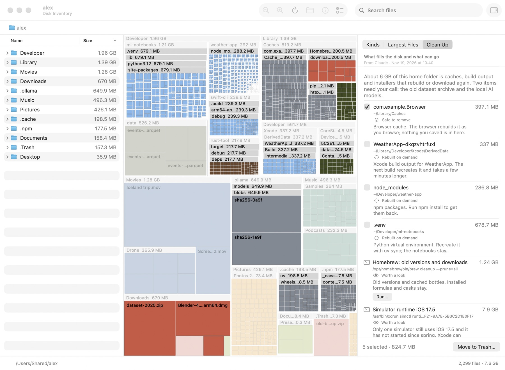

# Disk Inventory

Нативный порт Disk Inventory X для macOS 26 и Apple Silicon: карта занятого места, дерево и типы файлов, уборка (что можно удалить и что давно не открывали) и MCP-сервер, через который агент видит тот же скан.


## Быстрый старт

```sh
git clone git@github.com:kpeeem/DiskInventory.git
```

```sh
cd DiskInventory && ./Scripts/build-app.sh
```

```sh
open "dist/Disk Inventory.app"
```

Нужны Xcode 27 и macOS 26. Скрипт подписывает приложение первым сертификатом из Связки ключей (если его нет — ad hoc), поэтому «Полный доступ к диску» не слетает после пересборки. Без этого доступа защищённые папки попадут в **skipped**.

MCP-сервер для Claude Code:

```sh
./Scripts/build-mcp.sh
```

```sh
claude mcp add --scope user inventory "$PWD/dist/inventorymcp"
```

## Уборка и советы Claude

Вкладка **Clean Up** в инспекторе (или **File → Clean Up…**, ⇧⌘K, или кнопка в тулбаре). Пока она открыта, карта приглушает всё, кроме кандидатов; выбор строки выделяет объект в дереве и на карте, пробел открывает Quick Look.



- **Claude’s Analysis** — то, что прислал агент через `inventory_advise`: путь, размер, вердикт (*safe*, *regenerable*, *review*, *keep*) и объяснение, почему это безопасно. Безопасные пункты отмечены заранее, «keep» удалить нельзя, через контекстное меню можно сказать «Keep».
- **Правила приложения**: *Safe to Remove* — кэши программ, журналы, Корзина (её очищают в Finder); *Rebuilt on Demand* — `node_modules`, `.build`, `target`, виртуальные окружения Python и прочие артефакты рядом с файлом проекта, кэши npm/uv/pip/Gradle/Cargo, DerivedData; *Worth a Look* — установщики в Загрузках и на Рабочем столе, локальные модели, устройства симулятора, архивы Xcode, резервные копии iPhone. Внутри `~/Library` (кроме перечисленных мест), скрытых папок домашней и пакетов приложений артефакты не ищутся.
- **Not Opened Lately** — крупные файлы в Desktop, Documents, Downloads, Movies, Music, Pictures и iCloud Drive, которые не открывали и не меняли дольше выбранного срока (дата — самая поздняя из «открыт» по Spotlight, «изменён» и «добавлен»). Их можно перенести в iCloud Drive или Google Drive в папку «Archived from Mac», а у файлов из iCloud — убрать локальную копию.

Всё уходит в Корзину только после подтверждения; скан обновляется точечно, а статусы советов (перемещено, оставлено) видны агенту.

### Как это работает с агентом

1. Вы спрашиваете Claude «чем забит диск, что почистить».
2. Claude меряет через `inventory_scan` / `inventory_cleanup` / `inventory_stale` и отправляет выводы `inventory_advise` — приложение открывается на вкладке Clean Up.
3. Вы отмечаете, что удалить, и подтверждаете; `inventory_advice` показывает агенту, что вы перенесли в Корзину и что оставили.

Советы хранятся в `~/Library/Application Support/DiskAdvice/advice.json` и объявляются распределённым уведомлением, поэтому их видит и DiskSpot. Пути вне домашней папки и известных кэшей, а также целые `~/Library`, `~/Documents`, `~/Dev` отклоняются для любого вердикта, кроме «keep».

## Сканирование

На APFS обход параллельный: общая очередь папок, свободные потоки забирают поддеревья, до которых занятые ещё не дошли; атрибуты читаются пакетами через `getattrlistbulk`, а части скана сливаются с перенумерацией узлов и однократным учётом hard links. Выгруженные в iCloud (dataless) папки учитываются, но не открываются, так что скан ничего не скачивает.

| Каталог | Записей | 1.5, один поток | 1.6, очередь |
|---|---:|---:|---:|
| `/Applications/Xcode.app/Contents/Developer` | 152 452 | 1,3–2,5 с | 1,0–1,6 с |
| `~/Dev` | 3,9 млн | 121 с | 31 с |
| `~` целиком | 8,2 млн | около часа в 1.3 | 132 с |

Число записей и байты совпадают с последовательным обходом; пик памяти на `~/Dev` — 1,0 ГБ против 0,75 ГБ (части скана живут до слияния).

## MCP

`inventorymcp` держит скан в памяти 30 минут. Файлов он не удаляет — только читает и передаёт советы в приложение:

| Инструмент | Что делает |
|---|---|
| `inventory_scan` | полный скан папки или тома (`/System/Volumes/Data` — весь загрузочный том) |
| `inventory_children`, `inventory_top` | обход по уровням и самые большие файлы или папки где угодно внутри |
| `inventory_kinds`, `inventory_search` | место по типам файлов и поиск по имени, типу или пути |
| `inventory_cleanup` | то же, что вкладка Remove, с суммами по уровням безопасности |
| `inventory_stale` | то же, что вкладка Move to Cloud, плюс найденные облачные папки |
| `inventory_status` | доступ к защищённым папкам, облачные папки, сканы в памяти |
| `inventory_advise`, `inventory_advice`, `inventory_advice_clear`, `inventory_show_cleanup` | отправить советы во вкладку Clean Up, прочитать решения пользователя, убрать советы, открыть вкладку |

## Работа с картой

- Площадь прямоугольника пропорциональна размеру; у достаточно крупных папок есть заголовок с именем и размером. Дерево, карта и списки показывают одно выделение (акцентная рамка). Двойной клик или Return приближает папку, путь над картой и ⌘↑ возвращают назад, стрелки переходят между плитками, пробел открывает Quick Look.
- **Kinds** показывает размеры по типам файлов; цвета карты даны по категориям (видео, изображения, программы, разработка, документы, данные…). Выбор типа подсвечивает его плитки.
- **Largest Files** — файлы по размеру; поиск по имени, типу или папке живёт в поле тулбара, совпадения подсвечиваются на карте.
- Открытие, Quick Look, Finder, Get Info (немодальная панель), копирование пути, приближение, **Rescan Selection** и перенос в Корзину — в контекстном меню. **Rescan** (⌥⌘R) пересканирует окно.
- В меню **View** переключаются размер на диске и логический размер, содержимое пакетов, свободное и прочее место, **Show/Hide Inspector**, **Show Largest Files**.
- При выборе загрузочного тома сканируется его записываемая часть APFS (окно называется по тому). Для тома показывается процент по объёму и признак «ждёт доступа», если macOS задерживает чтение папки. Перед сканом тома без Full Disk Access приложение предлагает его включить; пропуски сгруппированы по причине с кнопкой **Open Privacy Settings**.

## Настройки

**Disk Inventory → Settings… (⌘,)** — вкладки в тулбаре.

- **Appearance** — четыре палитры карты с предпросмотром (без фиолетовых тонов), подписи, границы папок, расположение панелей и компактный текст дерева. Светлая и тёмная тема — по системной настройке.
- **Scanning** — размер на диске или логический размер, содержимое пакетов, названия типов Finder и показ свободного и прочего места.
- **Behavior** — анимация зума, синхронизация с Finder, подтверждение переноса в Корзину и напоминание о Full Disk Access.

## Проверка

```sh
CLANG_MODULE_CACHE_PATH="$PWD/.build/module-cache" swift test --disable-sandbox --cache-path "$PWD/.build/cache"
```

Сквозные проверки окна (выбор томов, скан, синхронизация, зум, поиск, раскладка, настройки, Корзина):

```sh
binary="dist/Disk Inventory.app/Contents/MacOS/DiskInventory"
"$binary" --smoke-test /path/to/folder
"$binary" --layout-smoke-test /path/to/folder
"$binary" --settings-smoke-test /path/to/folder
"$binary" --trash-smoke-test
```

CLI сканирует метаданные без открытия окна. Флаг `--finder-kinds` включает подробные имена типов для `--scan` и `--fts`. Ключ `--fts` запускает прежний файловый обход для сравнения. Ключ `--baseline` обходит дерево через Foundation и считает число объектов и логические байты.

```sh
binary="dist/Disk Inventory.app/Contents/MacOS/DiskInventory"
"$binary" --scan /Applications/Xcode.app/Contents/Developer
"$binary" --fts /Applications/Xcode.app/Contents/Developer
"$binary" --baseline /Applications/Xcode.app/Contents/Developer
```

[Разбор установленной Disk Inventory X 1.3 и замеры](Research/analysis.md).
