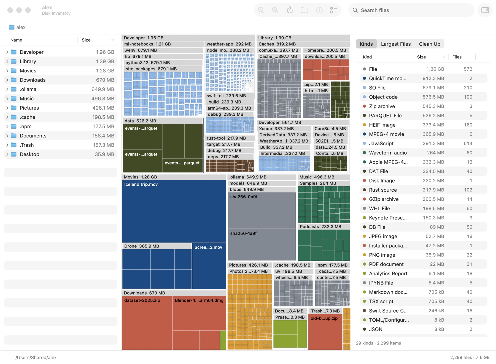
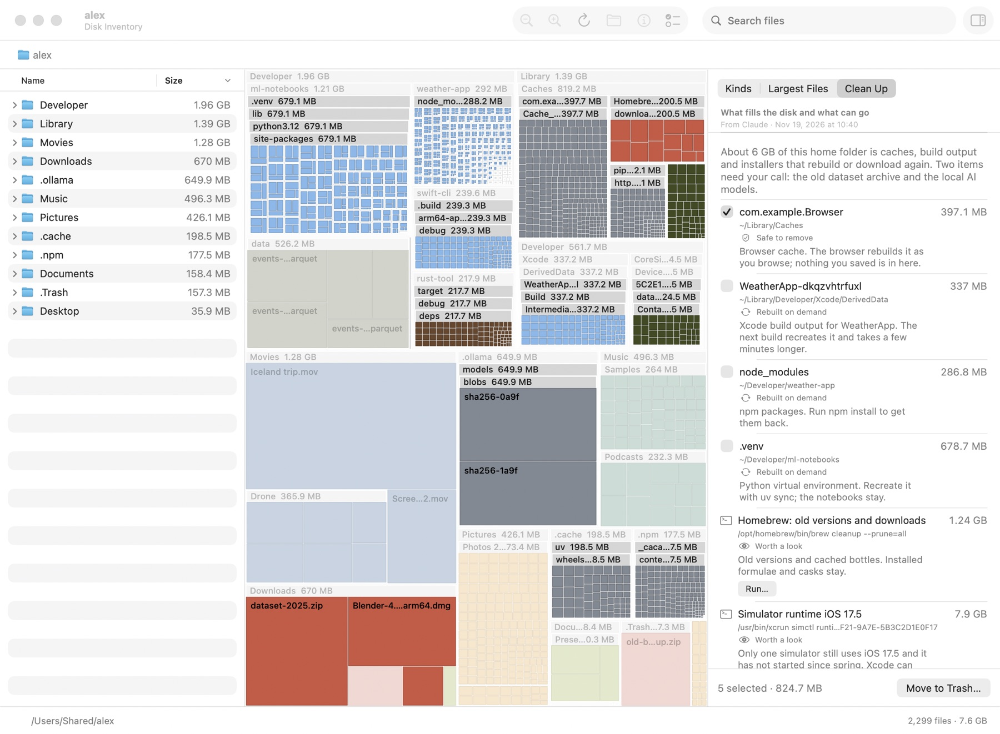
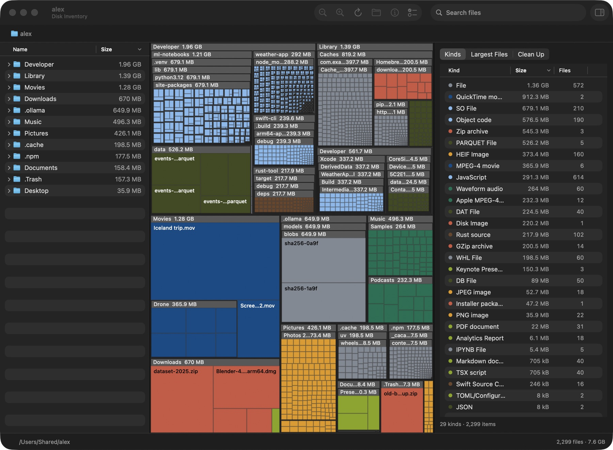

# Disk Inventory

[](https://github.com/kpeeem/DiskInventory/releases/latest)
[](LICENSE)


[English](README.md) · Русский

> **TL;DR** — нативная версия Disk Inventory X на Swift для Apple Silicon: карта всех файлов, вкладка уборки, где мусор разложен по степени риска, и MCP-сервер, через который Claude сканирует диск и присылает советы прямо в приложение. Без вашего подтверждения ничего не удаляется.



## Установка

1. Скачайте `DiskInventory-*.zip` со страницы [Releases](https://github.com/kpeeem/DiskInventory/releases/latest) и перенесите приложение в «Программы».
2. Сборка не нотаризована. При первом запуске откройте **Системные настройки → Конфиденциальность и безопасность → Всё равно открыть** или выполните:

```sh
xattr -dr com.apple.quarantine "/Applications/Disk Inventory.app"
```

3. По желанию дайте **Полный доступ к диску**, чтобы видеть Почту, Сообщения и части Library.

Сборка из исходников (Xcode 26+, macOS 26):

```sh
git clone https://github.com/kpeeem/DiskInventory.git && cd DiskInventory && ./Scripts/build-app.sh && open "dist/Disk Inventory.app"
```

## Что умеет

- **Карта, дерево и типы файлов.** Одно выделение на всех трёх, двойной клик приближает, пробел открывает Quick Look.
- **Быстро.** Параллельный обход APFS через `getattrlistbulk`: 8 млн файлов примерно за две минуты, файлы из iCloud не скачиваются.
- **Уборка.** Кэши, артефакты сборки, установщики, старые симуляторы и файлы, которые месяцами не открывали, по группам риска.



## Спросите Claude, что почистить

```sh
./Scripts/build-mcp.sh && claude mcp add --scope user inventory "$PWD/dist/inventorymcp"
```

Дальше спросите *«чем забит диск, что можно удалить?»*. Claude меряет через `inventory_scan` и `inventory_system` и присылает каждую находку с вердиктом и объяснением, а приложение подсвечивает её на карте. Вы отмечаете, что убрать, Claude видит, что вы решили.

> [!IMPORTANT]
> Агент ничего не удаляет сам. Пути уходят в Корзину только после подтверждения. Команды берутся из закрытого списка (`brew cleanup`, `simctl delete`, `docker prune`…), перед **Run…** приложение показывает точную команду. `/System`, `/usr` и системные настройки отклоняются.

<details>
<summary>Тёмная тема</summary>



</details>

Подробнее: [правила, инструменты MCP, замеры скорости, тесты](docs/details.ru.md) · Соседнее приложение: [DiskSpot](https://github.com/kpeeem/DiskSpot)

## Лицензия

[MIT](LICENSE). Проект не связан с оригинальной Disk Inventory X Тьярка Дерлина.
